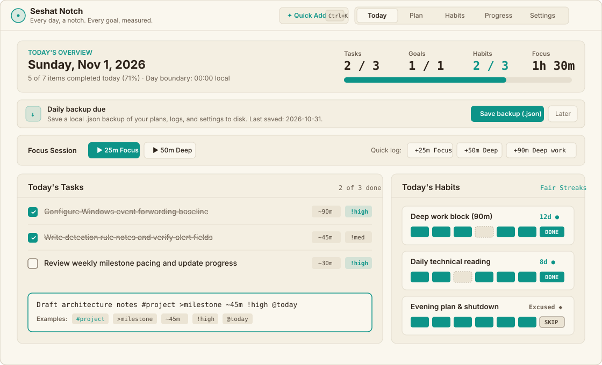
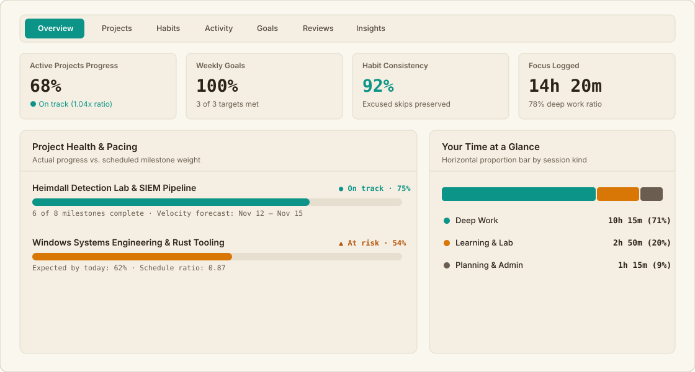

# Seshat Notch

> **Every day, a notch. Every goal, measured.**  
> *A local-first personal planning and tracking application for Windows, built for deep work and long-term mastery.*

[](LICENSE)
[](design.md)
[](https://github.com/Swashbuckler16/Seshat-Notch/actions)





---

## Install & Use on Windows

### Option 1: Install as a Windows Desktop Web App (Edge / Chrome)
- **Live App:** [https://swashbuckler16.github.io/Seshat-Notch/](https://swashbuckler16.github.io/Seshat-Notch/)
- **10-Page User Manual (.docx):** [`Seshat-Notch-User-Manual.docx`](Seshat-Notch-User-Manual.docx) (also in [`docs/Seshat-Notch-User-Manual.docx`](docs/Seshat-Notch-User-Manual.docx))
  1. Open [https://swashbuckler16.github.io/Seshat-Notch/](https://swashbuckler16.github.io/Seshat-Notch/) in **Microsoft Edge** or **Google Chrome** on Windows.
  2. Click the **Install app** icon in the right side of the address bar (or open the browser menu → **Apps** → **Install Seshat Notch**).
  3. Launch **Seshat Notch** from your Windows Start Menu or Taskbar. All fonts (`Inter` and `IBM Plex Mono`), icons (`192px`, `256px`, `512px`, `maskable`, `favicon.svg`), and shell assets are self-hosted and cached individually for 100% offline use.
  > **Note for GitHub Pages maintainers:** Ensure **Settings → Pages → Build and deployment** in your repository is set to **Deploy from a branch (`gh-pages` / `/ (root)`)**.

### Option 2: Native Windows Desktop Shell (Tauri v2 — `src-tauri/`)
For background system tray persistence when the window is closed:
- **System Tray & Close-to-Tray:** Closing the window minimizes Seshat Notch to the Windows system tray (`Open`, `Quick Add`, `Save Backup Now`, `Quit`).
- **Global Quick-Add Hotkey:** Press `Ctrl+Shift+K` from any Windows application to summon Quick Add.
- **Native Toast Notifications:** Fires scheduled reminders even when minimized to the system tray.
- **Silent Automatic Disk Backups:** Writes daily `.json` backups directly to `Documents/SeshatNotch/Backups/`.

---

## 1. Overview

Seshat Notch takes its name from **Seshat**, the ancient Egyptian goddess of writing, measurement, and records, who was depicted notching a palm rib to record the passing of years and stretching a measuring cord to survey foundations.

The app is built for personal mastery on Windows laptops and desktops:
- **Multi-Horizon Planning:** Define and connect targets across three horizons: monthly milestones, weekly goals, and daily tasks.
- **Plan vs. Reality:** Log what actually happened. Compare your plan to reality with visible, transparent mathematics.
- **Unified Tracking:** Manage technical projects, goals, daily habits, and routines in one cohesive system.
- **Local-First & 100% Private:** Zero telemetry, no ads, no external servers. All data stays offline on your machine with transactional writes (`db.transaction`) and an append-only change log for complete auditability.

---

## 2. Core Capabilities

- **Today Execution Strip:** A streamlined morning dashboard showing scheduled tasks, due habits, time estimates, a **"Daily backup due"** banner when today's backup hasn't been saved yet, and rapid one-click focus logging.
- **Configurable Local Day Boundary:** Choose when your planning day rolls over (`00:00` Midnight to `05:00 AM`) in **Settings → Privacy & Preferences** so late-night work sessions resolve `@today` to your local calendar date.
- **Multi-Horizon Planner:** Organize life areas, projects, milestones with finish-to-start dependencies, and cascade targets across months, weeks, and days.
- **Quick-Add Grammar:** Fast keyboard entry (`Ctrl+K` or `N` in-app, `Ctrl+Shift+K` globally in the Tauri desktop app, plus `Alt+1`..`Alt+5` for tab navigation):
  ```text
  Draft project specification #roadmap >phase1 ~45m !high @today +pages:5
  ```
- **Habit Tracker & Fair Streaks:** Flexible habit schedules (daily, weekdays, N times per week) with fair streak logic that accounts for scheduled rest days and excused sick/vacation pauses without breaking your momentum.
- **Time Tracker & Focus Mode:** Integrated focus timer with configurable work/break intervals, manual duration entry, and classification into deep work, shallow work, or deliberate learning.
- **Executive Dashboard:** All 7 views (`Overview`, `Projects`, `Habits`, `Activity`, `Goals`, `Reviews`, `Insights`) are directly accessible with custom SVG graphics (sparklines, Few-style bullet charts, burn-up curves, and horizontal focus breakdowns) and traceable formulas.
- **Reminders & Scheduled Prompts:**
  - *In Browser / Installed PWA:* Reminders are **off by default** and are checked every 60 seconds while the app tab or window is open.
  - *In Tauri Windows Desktop Shell:* Reminders run in the background via the system tray even when the main window is closed.
- **Data Ownership, Daily Backups & Recovery Bin:**
  - Shows a **"Daily backup due"** prompt on **Today** until you save a backup or snooze it for the day (or saves silently to `Documents/SeshatNotch/Backups/` in the Tauri desktop shell).
  - Full `.json` backups and snapshots preserve all projects, tasks, habits, logs, **and** your app preferences (day rollover boundary and reminder schedule).
  - Soft-deleted items are retained in a Recovery Bin with one-click restore.

---

## 3. Local Development & Packaging

### Prerequisites
- Node.js 22 LTS or newer
- *(Optional, for native `.msi` / `.exe` packaging)* Rust stable toolchain & Windows WebView2

### Commands
```powershell
# Install dependencies
npm install

# Start local development server
npm run dev

# Run Hallmark 58-gate design audit
npm run audit

# Run automated unit, IndexedDB, & static-server offline test suite (76 tests)
npm test

# Build production web & desktop assets
npm run build

# Run or package the Tauri Windows Desktop Shell (requires Rust toolchain)
npm run tauri:dev
npm run tauri:build
```

---

## 4. License

- **License:** [MIT](LICENSE) © 2026 Atharva Ghag (Swashbuckler16)
