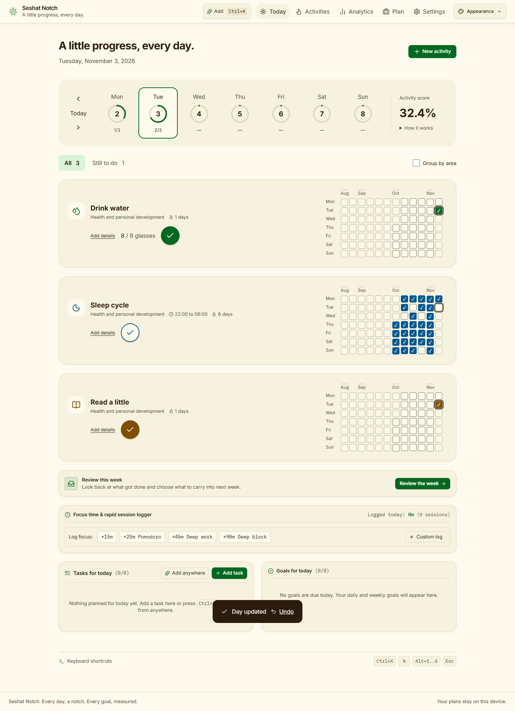
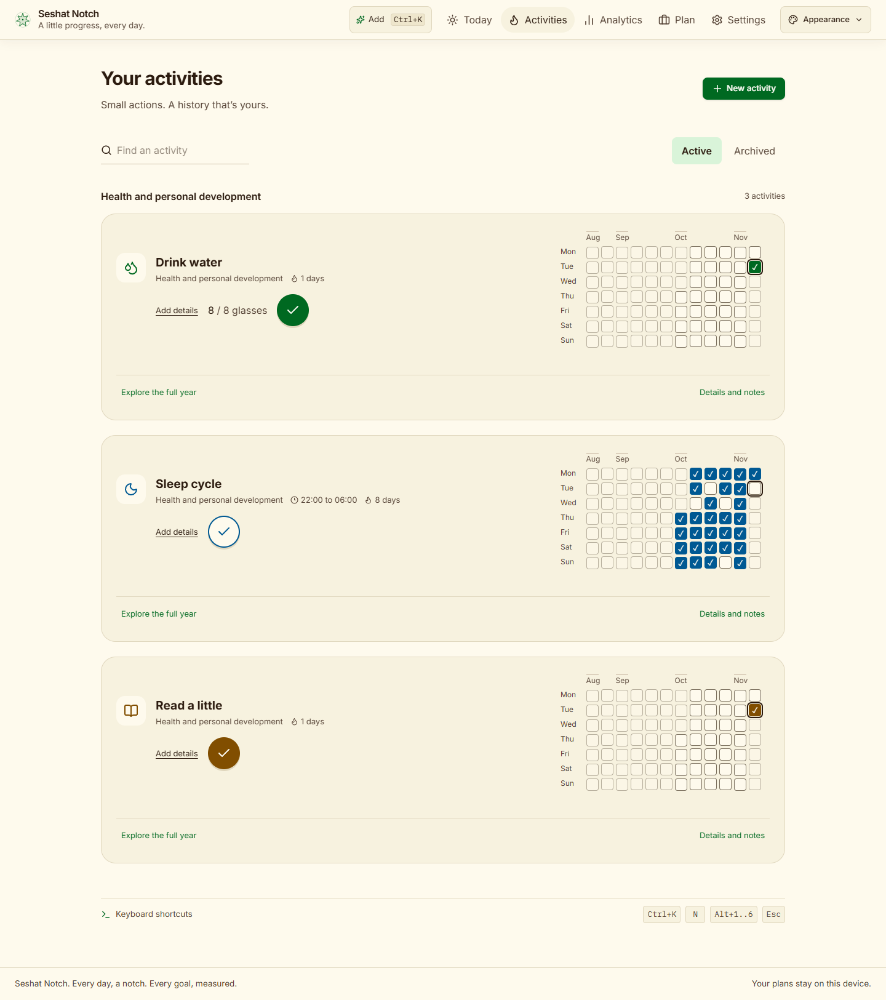
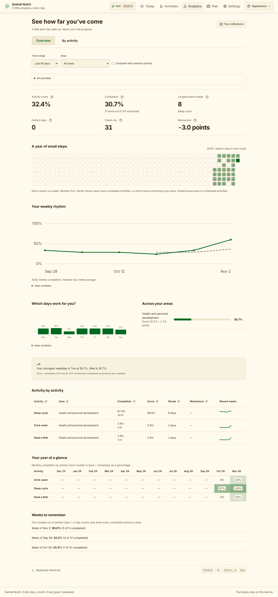

# Seshat Notch

A little progress, every day. A local-first activity tracker and planner built with React, TypeScript, Dexie and an optional Tauri desktop shell.



## Track your day

- **Today:** see your week, check off activities, record quantities, add notes and undo an accidental change.
- **Activities:** create checks, counts, measurements, time windows or avoidance activities. Choose an Area, color, schedule and start date. Explore past days, pause, archive or recover an activity.
- **Analytics:** explore completion, streaks, recent-weighted scores, momentum, weekday patterns, monthly history and area comparisons. Filter dates and activities; open explanations and data tables.
- **Plan:** keep projects, milestones, goals and tasks connected. Focus tools and reflections remain available.
- **Settings:** export/import backups, recover deleted items, choose a day boundary and set an optional PIN.





## Run locally

```sh
npm ci
npm run dev
```

Open the local address printed by Vite. For a production preview:

```sh
npm run build
npm run preview
```

For the optional desktop shell, install the Tauri prerequisites, including Rust and the Windows build tools, then use `npm run tauri:dev` or `npm run tauri:build`. The native installer was not built during this rebuild because Rust was unavailable.

## Your data

Data stays in the local `seshat_notch_db` database. Schema 3 upgrades existing records in place; it does not create a replacement database. Backups preserve activities, entries, plans and preferences. Save a backup before moving between browsers, devices or the desktop shell, which have separate storage.

The PIN is a screen lock, not encryption. Backups are readable JSON. Offline use works for cached app assets; visit screens once while online before relying on them offline.

Daily completion excludes rest days, pauses, excused days and an unfinished today. Weekly schedules use weekly quotas for streaks; completion charts show daily completion, not quota attainment. Scores and momentum are explained inside Analytics.

## Shortcuts

- `Ctrl+K`: Quick Add. Try `activity Read daily` or `tick Sleep cycle`.
- `Alt+1` through `Alt+5`: Today, Activities, Analytics, Plan, Settings.
- `Alt+6`: Reviews.
- Arrow keys: move through a history grid. `Escape`: close the current dialog.

## Verification and guide

```sh
npm test
npm run build
npm audit
```

The rebuild passed 91 tests, the production build and the dependency audit. Browser checks cover five screens, three widths and four theme combinations. Production route changes measured 385–432 ms with 40 activities and 29,200 entries in an isolated browser. See the [test report](docs/test-report.md) for scope, evidence and limitations.

- [User manual](docs/Seshat-Notch-User-Manual.docx)
- [Changes](CHANGELOG.md)
- [Implementation decisions](docs/decisions.md)

Screenshot records are isolated test fixtures, not preloaded personal statistics. This local rebuild has not been pushed or deployed.

## License

[MIT](LICENSE) © 2026 Atharva Ghag (Swashbuckler16)
